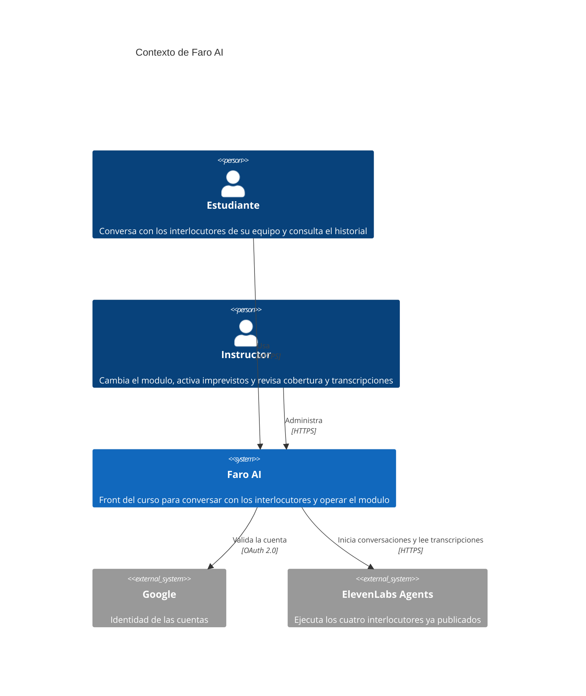
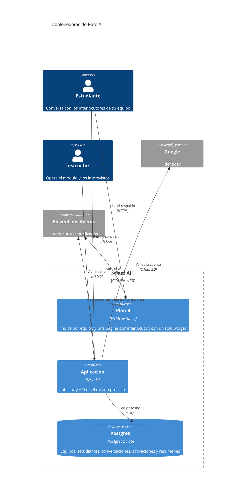
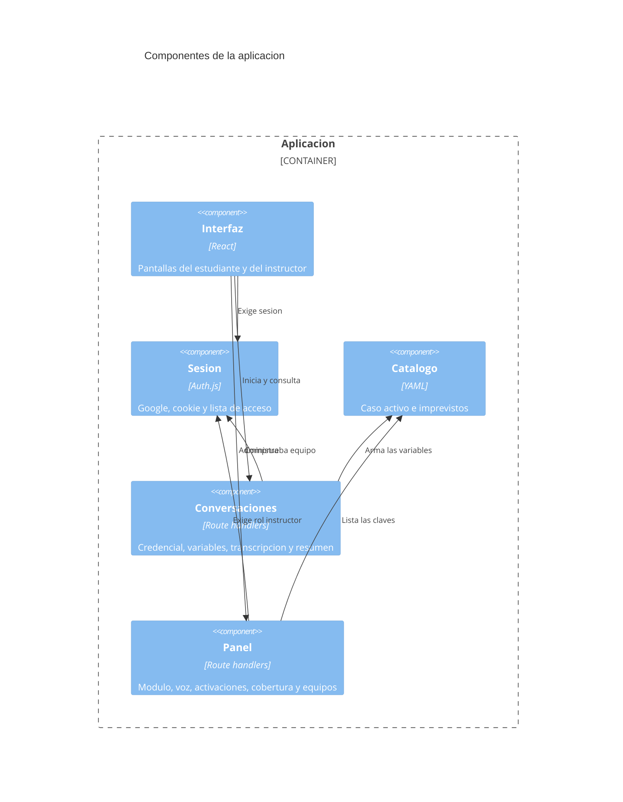

# Arquitectura C4

Fuente de verdad de la estructura. Niveles 1, 2 y 3. El nivel 3 entra porque la aplicación tiene más de un módulo con lógica propia.

## 1. Contexto

| Elemento | Responsabilidad |
| --- | --- |
| Estudiante | Entra con su cuenta, conversa y lee el historial de su equipo |
| Instructor | Define el módulo, activa imprevistos, carga equipos y lee cualquier transcripción |
| Faro AI | Marca, acceso, variables de cada conversación y panel |
| Google | Prueba la identidad. No guarda equipos ni conversaciones |
| ElevenLabs Agents | Corre los interlocutores. La configuración de los agentes vive en el kit, no aquí |

## 2. Contenedores

| Contenedor | Tecnología | Responsabilidad |
| --- | --- | --- |
| Plan B | HTML estático | Respaldo sin cuentas ni historial. Una página por interlocutor, con variables fijas |
| Aplicación | Next.js | Login, interlocutores, conversación, historial y panel |
| Postgres | PostgreSQL 16 | Estado del curso. En local, Docker. Gestionado solo cuando se apruebe el despliegue |
| Google | OAuth 2.0 | Identidad |
| ElevenLabs Agents | HTTPS | Conversación, transcripción y resumen |

## 3. Componentes de la aplicación

| Componente | Responsabilidad |
| --- | --- |
| Interfaz | Tarjetas, conversación en texto y en voz si la cohorte la habilita, historial y formularios del instructor |
| Sesión | Login con Google y rechazo de correos que no están en la lista |
| Catálogo | Lee `config/casos.yaml` y `config/imprevistos.yaml` |
| Conversaciones | Pide la credencial, guarda el id y lee transcripción y resumen |
| Panel | Cambia el módulo y la voz de la cohorte, activa claves, muestra cobertura y administra equipos |
