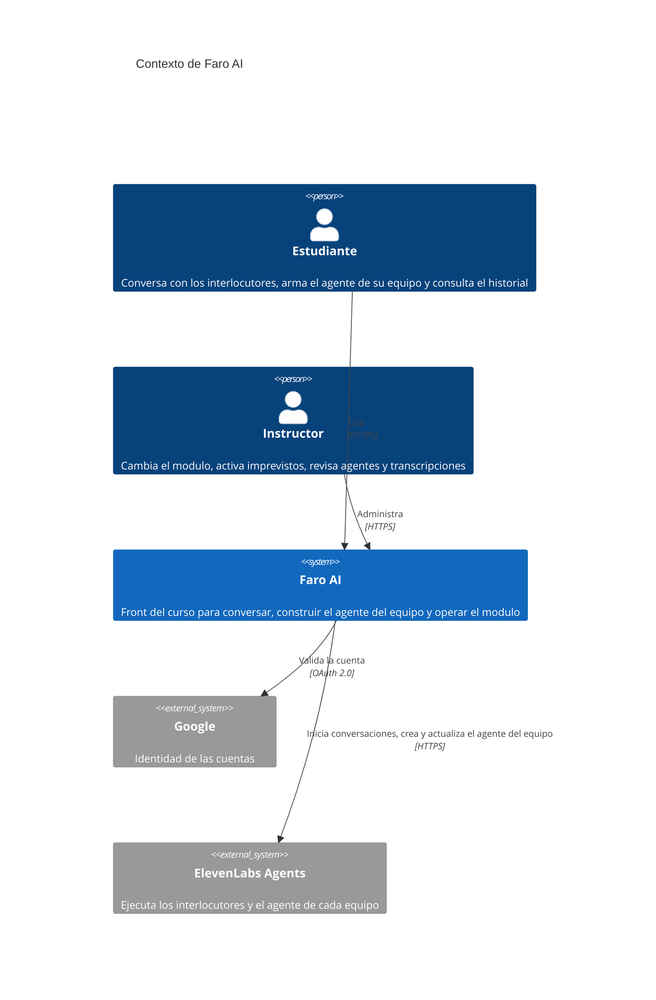
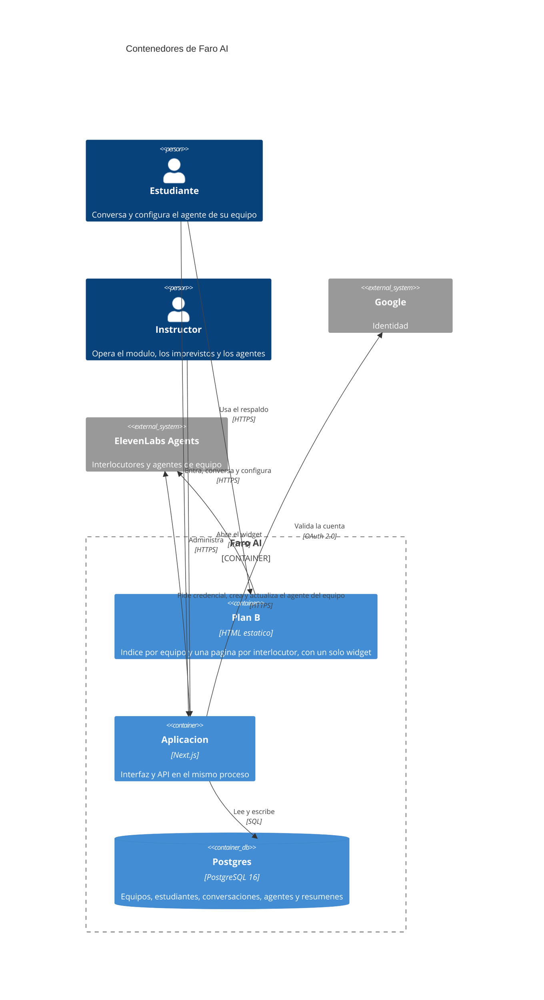
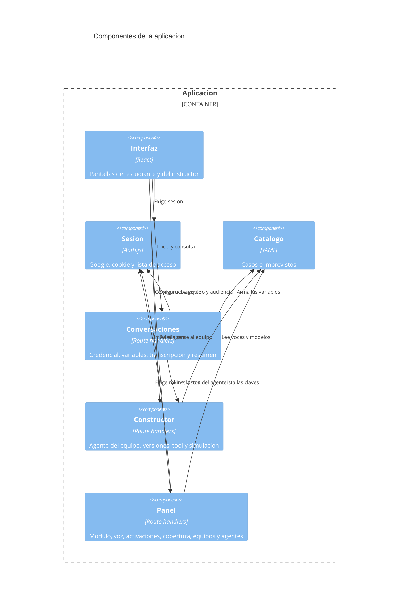

# Arquitectura C4

Fuente de verdad de la estructura. Niveles 1, 2 y 3. El nivel 3 entra porque la aplicación tiene más de un módulo con lógica propia.

## 1. Contexto

| Elemento | Responsabilidad |
| --- | --- |
| Estudiante | Entra con su cuenta, conversa, configura el agente de su equipo y lee el historial |
| Instructor | Define el módulo, activa imprevistos, carga equipos, revisa los agentes de los equipos y lee cualquier transcripción |
| Faro AI | Marca, acceso, variables de cada conversación, constructor y panel |
| Google | Prueba la identidad. No guarda equipos ni conversaciones |
| ElevenLabs Agents | Corre los interlocutores publicados y el agente que cada equipo guarda desde esta aplicación. Los ocho interlocutores siguen definidos en el kit |

## 2. Contenedores

| Contenedor | Tecnología | Responsabilidad |
| --- | --- | --- |
| Plan B | HTML estático | Respaldo sin cuentas ni historial. Una página por interlocutor, con variables fijas |
| Aplicación | Next.js | Login, interlocutores, constructor, conversación, historial y panel |
| Postgres | PostgreSQL 16 | Estado del curso y las versiones del agente de cada equipo. En local, Docker. Gestionado solo cuando se apruebe el despliegue |
| Google | OAuth 2.0 | Identidad |
| ElevenLabs Agents | HTTPS | Conversación, transcripción, resumen, y el agente que guarda cada equipo |

## 3. Componentes de la aplicación

| Componente | Responsabilidad |
| --- | --- |
| Interfaz | Tarjetas del caso de curso y, para el instructor, las de Seguros Pampa. Constructor del agente, conversación en texto y en voz cuando corresponde, historial y formularios del instructor |
| Sesión | Login con Google y rechazo de correos que no están en la lista |
| Catálogo | Lee `config/casos.yaml` y `config/imprevistos.yaml`. Separa el caso de curso del caso del instructor |
| Conversaciones | Pide la credencial, guarda el id, compara las variables que ElevenLabs registró con las emitidas y lee transcripción y resumen. Niega Seguros Pampa a un estudiante y archiva esas conversaciones en el equipo de demo. La sala del agente del equipo usa el mismo control |
| Constructor | Crea y actualiza un agente por equipo, guarda versiones, la tool y las simulaciones. No escribe los ocho interlocutores |
| Panel | Cambia el módulo y la voz de la cohorte, activa claves de cada caso, muestra cobertura, el control de variables, administra equipos y archiva agentes |
